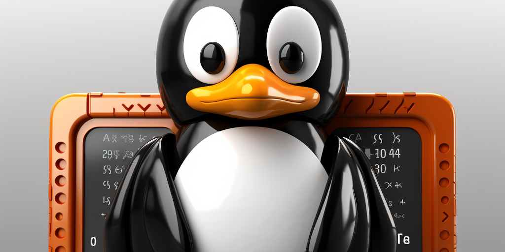

# deskterm

Turn your Linux desktop into a terminal.



deskterm pins a terminal window as the desktop background. The `deskterm`
launcher starts [devilspie2](https://www.nongnu.org/devilspie2/) (an X11
window-matching daemon) with the bundled rule, then opens a gnome-terminal
window with the X window role `Deskterm`. The rule catches that window,
moves it to the origin, maximizes it, re-types it as the desktop window
(`_NET_WM_WINDOW_TYPE_DESKTOP`), and pins it to all workspaces.

## Requirements

- **An X11 session.** devilspie2 matches and re-types X windows via
  libwnck/EWMH, which is impossible under **Wayland** — there is no protocol
  for a third-party client to re-type another client's window. On GNOME,
  pick "GNOME on Xorg" at the login screen. deskterm refuses to start in a
  Wayland session rather than half-working.
- `devilspie2` and `gnome-terminal`:

  ```sh
  sudo apt-get install devilspie2 gnome-terminal
  ```

## Install

```sh
git clone https://gitlab.com/bitspur/misc/deskterm.git
cd deskterm
sudo make install
```

`make install` honours `PREFIX` (default `/usr/local`) and `DESTDIR` for
packaging. The XDG autostart entry lands in `$(PREFIX)/etc/xdg/autostart`;
desktop environments only read `/etc/xdg/autostart` (and
`~/.config/autostart`) by default, so for autostart either install with

```sh
sudo make install PREFIX=/usr sysconfdir=/etc
```

or copy the entry per user:

```sh
cp share/deskterm.desktop ~/.config/autostart/
```

Uninstall with `sudo make uninstall` (same `PREFIX`/`sysconfdir` values).

## Usage

1. Create a gnome-terminal profile named `Deskterm` (a transparent or
   borderless look works best).
2. Run `deskterm`, or log out and back in if you installed the autostart
   entry.

The launcher copies the devilspie2 rule into
`~/.config/devilspie2/deskterm.lua` (refreshing it when it changes), starts
devilspie2 if it isn't already running, and opens the terminal window.

| Environment variable | Default      | Purpose                              |
| -------------------- | ------------ | ------------------------------------ |
| `DESKTERM_PROFILE`   | `Deskterm`   | gnome-terminal profile to use        |
| `DESKTERM_RULE`      | auto-detected | path to the devilspie2 rule file    |

## Hotkey

To toggle between the desktop terminal and your applications, bind GNOME's
"Hide all normal windows" shortcut (Settings → Keyboard → Shortcuts →
Navigation), e.g. to `Ctrl+Alt+D`. Desktop-type windows stay visible when
normal windows are hidden.

## Development

```sh
make prepare    # one-time toolchain bootstrap (asdf, cloc)
make lint       # shfmt -d + shellcheck (default goal)
make format     # shfmt -w
make test       # unit tests (bats, X tooling mocked via PATH shims)
make test/e2e   # headless smoke: devilspie2 + rule under Xvfb in docker
```

The unit suite mocks `devilspie2`, `gnome-terminal`, and `pgrep` with PATH
shims to assert the launcher constructs the right commands. The e2e suite
runs the real devilspie2 against the bundled rule under Xvfb + openbox in a
throwaway Debian container and asserts a `Deskterm`-role window is re-typed
as the desktop window. The full visual effect (terminal drawn as your
wallpaper) still needs a real X11 desktop session.

## Support

Tested on Ubuntu with GNOME Shell on Xorg. Any EWMH-compliant X11 window
manager should work. Wayland sessions are not supported (see Requirements).

## License

[GPL-3.0](LICENSE)
